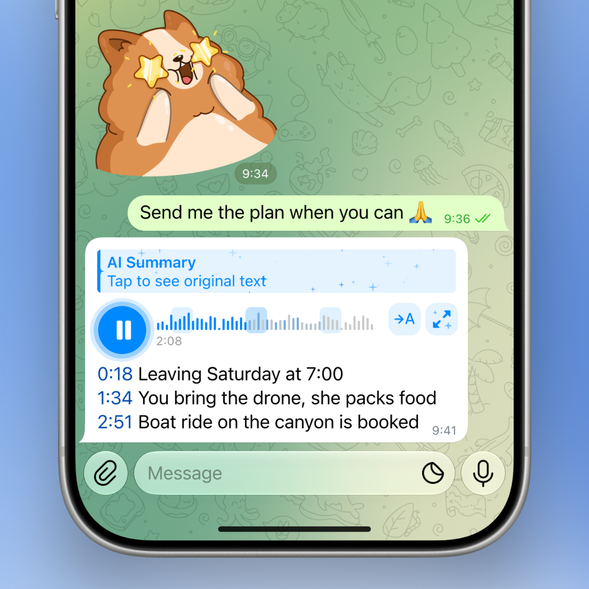

# AI Summary of Voice Messages for Telegram iOS

Get the gist of a long voice message without listening to all of it. Tap the summary button inside the voice message, next to transcription: the key points appear under the waveform, each starting with the moment it was said, and a tap on a timecode plays the voice from there.

[](Media/demo.mp4)

▶︎ [Media/demo.mp4](Media/demo.mp4) — the concept, animated (11 s).

## Why

Telegram already summarizes long text messages (AI Summary) and turns voice messages into text (voice-to-text). The messages that take the longest to get through are long voice messages, and they have no summary: a four-minute voice is either four minutes of listening or a wall of transcribed text.

This brings AI Summary to voice messages. The summary is made of a few points, each with the moment of the voice it comes from, so it works both as a summary and as a way to jump to the part that matters.

## What it does

- **A summary button in the voice message.** For a voice message of 30 s or more that can be transcribed, a button with AI Summary's own icon and its two blinking stars sits in the row, right of the transcribe button and drawn like it. The waveform makes room for it.
- **While it works.** The waveform shimmers the way it does while a voice message is being transcribed, and the transcribe button's own progress ring runs round the summary button.
- **The summary.** The points appear under the waveform, where a transcription goes, one a line, each led by its timecode. The message gets the same "AI Summary / Tap to see original text" header that a summarized text message has.
- **Timecodes play the voice.** A tap on a timecode plays the voice message from that moment, through the app's own timecode handling, as a timecode in a message already does.
- **Back to the original.** A tap on the button hides the summary, and another tap shows it again at once. A tap on the header hides it and shows the voice message's full transcription instead.

## How it works

| Piece | Where |
| --- | --- |
| The summary's state, the points, the button | `ChatMessageVoiceSummary.swift` (new) |
| The button in the row, the shimmer, the summary under the waveform, the timecodes' hit test | `ChatMessageInteractiveFileNode.swift` |
| A tap on a timecode | `ChatMessageFileBubbleContentNode.swift` |
| The "AI Summary" header and its tap | `ChatMessageBubbleItemNode.swift` |

- **The button.** `VoiceSummaryButtonView` is 30 × 30 with a corner radius of 10, in the transcribe button's colours (`reactionActiveBackground` on `reactionInactiveBackground`). Its icons are AI Summary's own (`Chat/Message/CollapseIcon`, then `ExpandIcon`), swapped with the same 0.25 s scale animation as on the summary button of a text message, and it carries that button's two blinking `ParticleStar`s. While the summary is being made, the transcribe button's `voicets_progress` animation loops round it.
- **The layout.** The voice row lays the button out the way it lays out the transcribe button: the row is 38 pt wider, the transcribe button steps one place to the left and the waveform is 34 pt shorter. While the summary is being made, the waveform gets the transcription's in-progress shimmer.
- **The summary.** Once made, the points are laid out as the file node's text, the slot a transcription uses, so it grows into the bubble with the transcription's own animation. Timecodes are drawn in the link colour, as Telegram draws a timecode, and carry their time as a text attribute.
- **The header.** The bubble treats a voice message showing its summary as summarized: it shows the reply block in its "AI Summary" form, with its sparkles. Its tap hides the summary and expands the transcription.
- **Timecodes.** A tap on one returns the bubble's existing `.timecode` action, which goes to `seekToTimecode` and plays the voice message from that time.
- **Making the summary.** `VoiceSummarizer` takes the voice message's transcription (Telegram's voice-to-text: the stored one, or a new `transcribeAudio` request) and makes the points on the device. A production version would get them from the server, the way `messages.summarizeText` summarizes a text message, and store them with the message.

## Repository

| Path | What |
| --- | --- |
| `changes.patch` | The whole feature as one patch for Telegram-iOS: 5 files, +522 −1 |
| `Sources/ChatMessageVoiceSummary.swift` | The new file from the patch, for reading |
| `Media/demo.mp4` | The concept, animated |

## Changes

| File | Change |
| --- | --- |
| `submodules/TelegramUI/Components/Chat/ChatMessageInteractiveFileNode/Sources/ChatMessageVoiceSummary.swift` | New: the summary's state, the stub summarizer, the button |
| `submodules/TelegramUI/Components/Chat/ChatMessageInteractiveFileNode/Sources/ChatMessageInteractiveFileNode.swift` | The button in the voice row, the shimmer while it works, the summary under the waveform, timecode hit test |
| `submodules/TelegramUI/Components/Chat/ChatMessageInteractiveFileNode/BUILD` | Two dependencies: `AppBundle`, `LottieAnimationComponent` |
| `submodules/TelegramUI/Components/Chat/ChatMessageFileBubbleContentNode/Sources/ChatMessageFileBubbleContentNode.swift` | A tap on a summary's timecode |
| `submodules/TelegramUI/Components/Chat/ChatMessageBubbleItemNode/Sources/ChatMessageBubbleItemNode.swift` | The "AI Summary" header for a voice message and its tap |

## Trying it

This is a change to the Telegram-iOS source tree, not a standalone app. Apply the patch to a checkout of [TelegramMessenger/Telegram-iOS](https://github.com/TelegramMessenger/Telegram-iOS) (made against `master` at `24638bc69b`, 3 Nov 2026) and build the app as usual:

```sh
git apply changes.patch
```

Open a chat with a voice message of 30 s or more, tap the summary button right of the transcribe button, then tap a timecode in the summary.

## Limitations

- **The summary is a stub.** No AI model is called. The points are sentences from the voice message's transcription, the one that opens each third of it, with the time estimated from where the sentence stands in the text. The demo video shows the kind of summary a real model would return.
- **It needs a transcription.** The stub reads Telegram's voice-to-text, which needs Telegram Premium or a free trial; without one the button gives no summary.
- **The summary is kept in memory** on the device and is gone when the app restarts.
- **No press highlight** on a summary's timecodes, and the button's accessibility label is English only.
- **Verified:** the app builds for the simulator. **Not verified:** the feature in a running app with an account.

## Media

The video is a concept render, not a screen recording. Two touches in it are not in the code: the moments marked on the waveform and the playhead sliding to a timecode.

## License

Telegram-iOS is distributed under the GNU General Public License v2.0, and so is this patch. See [LICENSE](LICENSE).
